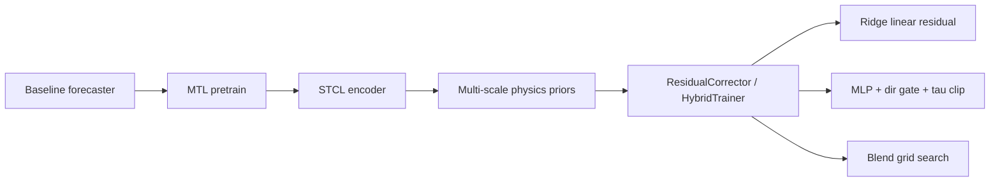

# Time-Series Forecasting with CRC

This repository implements **CRC** (Causal Residual Corrector) on top of a [Time-Series-Library](https://github.com/thuml/Time-Series-Library)-style **long-term forecasting** codebase.

**Entry point**: `python run.py --model CRC --baseline_model <Backbone>`

---

## CRC pipeline (post spec Phase 3)



**Formula**: `ŷ_final = ŷ_baseline + w1·r_lin + w2·clip(r_nl, ±τ)`

Two stages:
1. Train (or warm-start) a **baseline** forecaster.
2. Train **`ResidualCorrector`** on baseline outputs (MTL → hybrid correction).

---

## Module keep / remove (ablation-driven)

See `spec/ablation_results.md` for full numbers.

| Module | Decision |
|--------|----------|
| MTL pretraining | **KEEP** |
| STCL graph encoder | **KEEP** |
| Full multi-scale physics priors | **KEEP** |
| Direction gate | **KEEP** |
| Per-(node,h) blend grid search | **KEEP** |
| `--tau_scale` inference knob | **REMOVED** (use `--crc_tau_quantile` + retrain) |

**Legacy tag**: `crc-legacy` · **Current checkpoint version**: `crc-slim-v1`

---

## Repository layout

| Path | Role |
|------|------|
| `run.py` | Main launcher |
| `exp/exp_crc.py` | CRC train/test orchestration |
| `models/CRC.py` | `CRCConfig`, `ResidualCorrector`, `HybridTrainer`, encoders |
| `spec/` | Requirements, design, task, baseline & ablation results |
| `scripts/` | Analysis utilities |
| `run_crc_batch.sh` | Batch CRC experiments |
| `run_crc_tau_quantile_sweep.sh` | Sweep `--crc_tau_quantile` (replaces deprecated tau_scale sweep) |
| `run_crc_tau_scale_sweep.sh` | **DEPRECATED** — see A6 / Phase 4 |

---

## Environment

```bash
pip install torch numpy pandas scikit-learn matplotlib tqdm einops psutil networkx scipy patool sktime reformer-pytorch PyWavelets
```

Place datasets under `./dataset/` (see Time-Series-Library layout).

---

## Quick start

```bash
python run.py \
  --task_name long_term_forecast \
  --is_training 1 \
  --model CRC \
  --baseline_model DLinear \
  --model_id my_crc \
  --data ETTh1 \
  --root_path ./dataset/ETT-small/ \
  --data_path ETTh1.csv \
  --features M \
  --seq_len 96 --label_len 48 --pred_len 96 \
  --enc_in 7 --dec_in 7 --c_out 7 \
  --d_model 512 \
  --crc_encoder_layers 3 \
  --crc_tau_quantile 0.5 \
  --des CRC_exp
```

### CRC CLI (primary)

| Flag | Default | Meaning |
|------|---------|---------|
| `--baseline_model` | DLinear | Backbone forecaster |
| `--crc_encoder_layers` | 3 | STCL encoder depth |
| `--crc_tau_quantile` | 0.5 | τ quantile on validation residuals |
| `--crc_val_ratio` | 1.0 | Val window fraction for corrector training |
| `--crc_skip_retrain` | off | Load saved corrector checkpoint |
| `--crc_ckpt_dir` | auto | Corrector checkpoint directory |
| `--warm_start` | off | Reuse baseline checkpoint if present |

### Ablation flags (default = legacy on)

| Flag | Meaning |
|------|---------|
| `--crc_use_mtl` | MTL pretraining |
| `--crc_use_dir_gate` | Direction gate on nonlinear residual |
| `--crc_use_blend` | Blend grid search |
| `--crc_use_stcl` | STCL vs TemporalEncoder |
| `--crc_use_priors` | Physics priors |
| `--crc_use_minimal_priors` | Minimal priors (last/diff1/ema_12) |

**Legacy**: `--q_val` still maps to encoder layers + tau quantile if new params omitted.

**Removed**: `--tau_scale` — tune τ via `--crc_tau_quantile` and retrain stage-2.

---

## Evaluation

Test logs report **MAE**, **MSE**, **NDR** (non-degradation rate), and **Correction coverage**.

Optional: `--use_dtw`, `--inverse`

---

## Spec workflow

| Phase | Status |
|-------|--------|
| 0 Legacy baseline | Done — `spec/baseline_results.md` |
| 1 Equivalence refactor | Done |
| 2 Ablation | Done — `spec/ablation_results.md` |
| 3 Merge simplifications | Done (τ_scale removed) |
| 4 Script cleanup | Pending |

---

## Citation

Cite upstream Time-Series-Library and your CRC paper/release when available.
