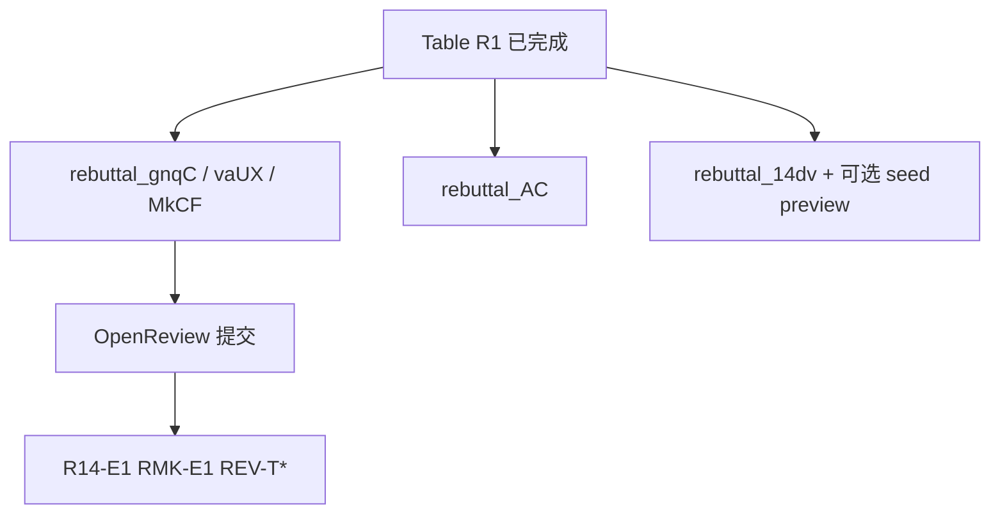

# CRC 审稿复验 — 设计文档（Design）

> **文档状态**：Draft v0.3  
> **依赖**：`review_spec/requirements.md`  
> **Table R1**：已完成 — 所有 reviewer rebuttal **优先引用**，不必重复跑 G4/G2

---

## 1. 工作流（v0.3）



---

## 2. Gated Baseline Ladder（实现）

| ID | CLI / 实现 | 状态 |
|----|------------|------|
| G0 | 测试日志 baseline 行 | done |
| G1 | `--crc_use_blend 0` | spec A2 |
| G2 | `--crc_ridge_gate_only 1` | **HybridTrainer**；`run_g2_experiments.sh` |
| G3 | `--crc_use_dir_gate 0` | spec A1 |
| G4 | `--crc_use_mtl 0 --crc_use_stcl 0 --crc_use_minimal_priors 1` | `run_r1_experiments.sh` |
| G5 | 默认 Full CRC | spec legacy |

**G2 实现说明（v0.3 取代 §4.2 方案 B 脚本）：**

- `ridge_gate_only=True`：跳过 MLP；blend 仅 `w1∈{0,1}`, `w2=0`
- 与 Full CRC **同 encoder/MTL/STCL/priors**，隔离 nonlinear + full blend grid

---

## 3. Multi-seed 设计（R14-E1）

```bash
# 示例：--fix_seed（run.py 默认 2021，与 legacy 一致）
for s in 2021 2022 2023; do
  python run.py ... --fix_seed "${s}" --model_id review_g5_b1_seed${s}
done
```

**最小集**：B1 上 G5 + G1（3 seeds）→ mean±std MAE/MSE/NDR。

**输出**：`rebuttal_results.md` §Multi-seed。

---

## 4. PIR 显著性（R14-E2）

- 输入：论文 Table 3 各 cell 或重跑 log
- 方法：跨 dataset×horizon 配对差分的 bootstrap 95% CI，或 Wilcoxon
- 脚本位置（待建）：`scripts/review/pir_crc_significance.py`

---

## 5. top_k 敏感性（RMK-E1）

- B1 Full CRC，`--top_k 3|5|7`（与 `build_corr_graph` 的 topk 一致）
- 对比 MAE/MSE/NDR vs default 5

---

## 6. AC 新颖性叙事模板（design 层）

**合成 novelty（非单点 trick）：**

1. **Problem**：always-on post-hoc correction → local harm（NDR）
2. **Mechanism**：ridge floor + gated nonlinear + **per-(var,h) validation blend**（含 shrink-to-base）
3. **Evidence**：Table R1 vs G1/G2

**与 prior 区分（一句话 each）：**

| Prior | CRC 差异 |
|-------|----------|
| TAFAS / PETSA / FAC | Test-time **adaptation** of backbone vs **frozen** backbone + post-hoc corrector |
| SOLID | Context shift **detector** vs **residual deployment firewall** on fixed val |
| PIR | Instance modulation strength vs **explicit (var,h) accept/reject + NDR** |
| FFORMA/FFORMA | Forecast **combination** vs **single backbone + selective residual** |

**Baseline 未纳入**：不同 problem setting；部分无公开代码/复现成本；revision Related Work 展开。

---

## 7. 脚本索引

| 脚本 | 用途 |
|------|------|
| `scripts/review/run_r1_experiments.sh` | G4 B1–B3 |
| `scripts/review/run_g2_experiments.sh` | G2 B1–B3 |
| `scripts/review/run_multi_seed.sh` | R14-E1 G5+G1 × 3 seeds |
| `scripts/review/run_topk_sweep.sh` | RMK-E1 top_k 3/5/7 |
| `scripts/review/pir_crc_significance.py` | R14-E2 |
| `scripts/review/summarize_review_logs.py` | 解析 `logs/review/*/run.log` |

---

## 8. Rebuttal 文档结构（统一引用 Table R1）

每份 rebuttal：

1. Thank + 1 句总结  
2. **Shared evidence**（可选 1 段指向 Table R1）  
3. 逐条 Weakness / Question  
4. Revision commitment  bullet  

---

## 9. Phase 划分

| Phase | 内容 |
|-------|------|
| **Done** | Table R1, gnqC rebuttal |
| **P0 rebuttal** | vaUX, MkCF, AC 文稿 |
| **P1 rebuttal** | 14dv + optional seed preview |
| **Revision** | R14-E1/E2, RMK-E1, REV-T1–T6 |
