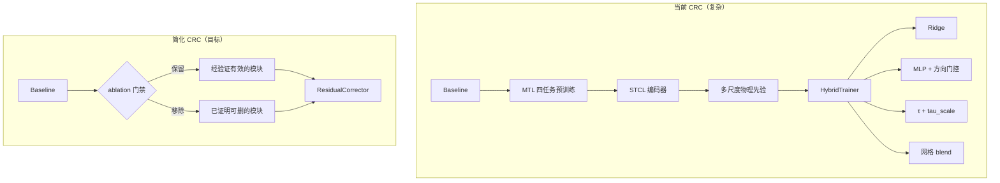
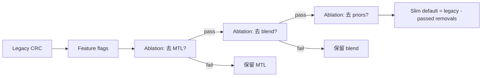

# CRC 简化版 — 设计文档（Design）

> **文档状态**：Draft v0.2  
> **依赖**：`spec/requirements.md`  
> **本阶段不涉及代码改动**  
> **最高优先级**：满足 requirements §2 R0（效果不劣化）

---

## 1. 设计目标

将 CRC 从「多层启发式堆叠系统」重构为更清晰、可维护的实现，**前提是不劣于 legacy CRC 的 MAE / MSE / NDR**。

目标公式（行为层，组件可增减）：

```
ŷ_final = ŷ_baseline + w1·r_lin + w2·clip(r_nl, −τ, +τ)
```

其中 `w1/w2`、编码器、先验等是否可简化为 `w1=w2=1`，**由 ablation 决定**，不在设计阶段预设。

设计原则（按优先级排序）：

1. **No regression first** — 任何简化必须通过 R0 基准矩阵  
2. **Evidence-driven removal** — 先度量、再删除；删不了就保留  
3. **One knob, one meaning** — 参数语义清晰化不牺牲效果  
4. **Behavior parity, code clarity** — 允许重构代码结构，但数值行为对齐 legacy  
5. **Ablation-ready** — 每个模块可独立开关，便于归因  

---

## 2. 架构总览

### 2.1 简化前后对比



### 2.2 简化策略：Parity-First Ladder（效果优先阶梯）

**禁止**一上来实现「最小架构」。正确顺序：

```
Step 0  冻结 legacy 指标（基准矩阵 B1–B3）
Step 1  为每个模块加 feature flag（默认 = legacy 全开）
Step 2  逐模块关闭 / 替换，跑基准矩阵
Step 3  仅「全矩阵 pass」的模块标记为 REMOVABLE
Step 4  合并 REMOVABLE 集合 → 新的默认配置
Step 5  在行为等价前提下重构代码（提取类、清参数语义）
```



### 2.3 目标数据流（行为参考）

```
Train:
  Stage-1  baseline.train()  →  ŷ_tr, ŷ_vl  (frozen)
  Stage-2  ResidualCorrector.train(W, y, ŷ)   # 内部模块按 ablation 结果组装
             ├─ [optional] encode(W) → Z        # STCL / Temporal / +priors
             ├─ fit Ridge: Z → (y − ŷ)
             ├─ estimate τ on val
             ├─ [optional] train MLP with τ clip
             └─ [optional] calibrate w1/w2 on val

Test:
  ŷ_final = ŷ + w1·r_lin + w2·clip(r_nl, ±τ·scale)
  # scale=1 为默认；仅当 ablation 证明可去掉 tau_scale 时移除 scale
  report MAE, MSE, NDR, clip_rate
```

---

## 3. 模块设计

### 3.1 文件结构（目标态）

```
models/
  CRC.py              # 精简：仅保留公共 API + 组装
  crc/
    __init__.py
    encoder.py        # TemporalEncoder, GraphEncoder (optional)
    corrector.py      # ResidualCorrector (Ridge + MLP + τ)
    graph.py          # build_corr_graph (optional)
    features.py       # minimal optional priors (≤3)

exp/
  exp_crc.py          # 编排两阶段；调用 ResidualCorrector

spec/
  requirements.md
  design.md
  task.md
```

> **Note**：是否拆分子包可在 task 阶段决定；若求最小 diff，可暂保留单文件 `CRC.py` 但逻辑分区用 comment block。

### 3.2 模块开关层（`CRCConfig`）

实现统一的配置对象，**默认等价 legacy**：

```python
@dataclass
class CRCConfig:
    # --- 经 ablation 前默认全开（legacy 行为）---
    use_mtl: bool = True
    use_physics_priors: bool = True      # full ms priors until ablation says otherwise
    use_dir_gate: bool = True
    use_blend_search: bool = True
    use_stcl_encoder: bool = True        # vs temporal_encoder
    tau_scale: float = 1.0               # keep until ablation finds train-time substitute

    # --- 语义清晰的新参数（映射到 legacy 行为）---
    tau_quantile: float = 0.5            # replaces q_val mapping when calibrated
    encoder_layers: int = 3              # maps from q_val for STCL
    graph_topk: int = 3
```

**默认配置 = 所有 legacy flag True**，确保 Step 0 重构后指标对齐。

### 3.3 `TemporalEncoder`（STCL 的候选替代）

**职责**：将输入窗口 `W (B, P, N)` 映射为节点特征 `Z (B, N, d)`。

**地位**：STCL 的 **候选替代**；仅当 `use_stcl_encoder=False` 且 ablation pass 时启用。

**默认**：`use_stcl_encoder=True`（保持 legacy STCL）。

```python
class TemporalEncoder(nn.Module):
    """
    Per-node: flatten last P steps → Linear(P, d) → GELU
    或 shared: Linear(P, d) 应用于每个节点（参数共享）
    """
```

| 属性 | 值 |
|------|-----|
| 输入 | `W`: (B, P, N) |
| 输出 | `Z`: (B, N, d) |
| 参数量 | O(P·d)，远小于 STCL |
| 预训练 | **无**；与 MLP 联合训练或 frozen Ridge 前 encode 一次 |

**设计理由**：是否采用 TemporalEncoder **不由设计文档预设**，由 ablation 决定。

### 3.4 `GraphEncoder` / STCL（legacy 默认开启）

**职责**：在相关图 A 上做轻量消息传递，输出 `Z_graph (B, N, d)`，与 `Z_temp` concat。

**精简 STCL 规则**（若保留）：

- 固定 `Q=1` 或 `Q=2`，**不可**与 τ 分位数共用超参
- 移除 `estimate_spatial_causality_matrix`、可视化、动态 a21 序列
- 移除 MTL；encoder 权重由 ResidualCorrector 端到端训练（或 frozen after 5-epoch warmup）

**默认**：`use_stcl_encoder=True`，保留现有 `TorchCausalStateEncoder` + `STCL_Core` 行为。

精简范围（不损效果前提下）：
- 移除可视化 / causality matrix API（**可立即做**，不影响指标）
- 将 `q_val` 拆为 `encoder_layers` 与 `tau_quantile` 两个独立参数，数值映射对齐 legacy

### 3.5 `PhysicsPriors`（legacy 默认全开）

仅保留 3 个 per-node 标量（在窗口末时刻计算）：

| 特征 | 公式 |
|------|------|
| `last` | `W[:, -1, n]` |
| `diff1` | `W[:, -1, n] − W[:, -2, n]` |
| `ema_s` | EMA over last `s=12` steps |

标准化：train 上 per-feature median/MAD，val/test 复用 train 统计量。

**默认**：`use_physics_priors=True`，保留 `build_physics_priors_ms` 全量行为。

**缩减路径**（须 ablation）：
1. 先跑 **逐特征组** ablation（统计 / 多尺度 / 频域）
2. 再尝试 `MinimalFeatures`（last, diff1, ema_12）
3. 仅当全矩阵 pass 才切换默认

### 3.6 `ResidualCorrector`（核心，包装 legacy HybridTrainer 行为）

#### 3.6.1 实现策略（两阶段，降低风险）

**Phase A — 包装层（行为等价）**  
先将现有 `HybridTrainer` 逻辑原样迁入 `ResidualCorrector`，通过 `CRCConfig` 控制开关；验证 B1–B3 与 legacy **数值对齐**（MAE/MSE/NDR 差异 < 0.1%）。

**Phase B — 逐模块简化**  
在 Phase A pass 后，按 task.md 的 ablation 顺序关闭模块。

#### 3.6.2 接口

```python
class ResidualCorrector:
    def __init__(self, encoder, H, N, *, tau_quantile=0.5, ...): ...

    def train(self, W_tr, y_tr, yhat_tr, W_vl, y_vl, yhat_vl) -> None: ...

    def predict(self, W, yhat) -> np.ndarray: ...
        # 返回 y_final (B, H, N)
```

#### 3.6.3 子组件（均可开关）

**A. Ridge 线性层（保底）**

- 与现实现一致：每个 node 独立 Ridge，输出 `(d, H)` 权重
- 仅在 `train()` 中 `np.linalg.solve`，推理时矩阵乘
- 超参：`crc_ridge_l2`（默认 `1e-2`）

**B. 非线性 MLP**

```python
class DeltaMLP(nn.Module):
    # 输入: Z_i + optional node_emb (d + 16)
    # 输出: (H,) per node
    net = Linear(d_in, 128) → GELU → Linear(128, H)
```

- 超参：`crc_mlp_hidden=128`, `crc_mlp_lr=1e-4`, `crc_mlp_epochs=60`, `crc_mlp_patience=20`
- **无** direction gate

**C. 安全边界 τ**

```python
# 在 val 上，Ridge 拟合完成后：
r_lin_vl = ridge_predict(Z_vl)
abs_res = |y_vl - (yhat_vl + r_lin_vl)|
tau_map = np.quantile(abs_res, q=tau_quantile, axis=0)  # (H, N)
tau_map = np.maximum(tau_map, tau_min)  # 默认 tau_min=1e-6
```

- **训练 MLP 时 τ 冻结**
- **推理时直接使用 τ**，无 `tau_scale`
- 敏感性分析：改变 `--crc_tau_quantile` 并 **重新 train stage-2**

#### 3.5.3 损失函数

训练 MLP 时：

```
r_lin = ridge(Z)                    # detached
r_nl  = MLP(Z)
r_nl_c = clamp(r_nl, -τ, +τ)
ŷ_pred = yhat + r_lin + r_nl_c
L = L1(ŷ_pred, y) + λ · mean(r_nl_c²)
```

- `λ = crc_nl_l2`（默认 `1e-4`），替代原 `l2_delta`

**D. 融合权重 w1/w2**

- legacy 默认：`use_blend_search=True`（网格搜索）
- 候选简化：固定 `w1=w2=1.0`
- **移除条件**：B1–B3 上 MAE/MSE/NDR 均不劣

**E. 方向门控**

- legacy 默认：`use_dir_gate=True`
- **移除条件**：NDR 不下降

#### 3.6.4 候选移除的 HybridTrainer 行为

| 原行为 | 处理 |
|--------|------|
| `_apply_dir_gate` | 默认保留；`use_dir_gate=False` ablation pass 后删除 |
| `W_blend` 网格搜索 | 默认保留；pass 后改为固定权重 |
| `tau_scale` | 默认保留；见 §4.4 |
| `build_physics_priors_ms` | 默认保留；ablation 后缩减 |
| matplotlib/networkx 可视化 | **可立即删除**（零指标风险） |

### 3.6 `Exp_CRC` 编排变更

```python
# exp/exp_crc.py 目标 train() 伪代码

def train(self, setting):
    self.baseline_model = train_or_warmstart_baseline()

    W_tr, y_tr, yhat_tr = predict_baseline(train_loader)
    W_vl, y_vl, yhat_vl = predict_baseline(val_loader)
    # optional: subsample val by crc_val_ratio

    encoder = build_encoder(args)  # TemporalEncoder or GraphEncoder

    self.corrector = ResidualCorrector(
        encoder=encoder,
        H=args.pred_len,
        N=y_tr.shape[-1],
        tau_quantile=args.crc_tau_quantile,
        ...
    )
    self.corrector.train(W_tr, y_tr, yhat_tr, W_vl, y_vl, yhat_vl)

    torch.save(self.corrector, crc_ckpt_path)
```

**Stage A/B 合并**为单一 `ResidualCorrector.train()`。

### 3.7 测试与指标

`test()` 保持与 LTF 对齐的 inverse 逻辑；指标：

```python
y_final = corrector.predict(W_te, yhat_te)
NDR = mean(mae_final <= mae_baseline + eps)  # per (H, C) then average
clip_rate = mean(|r_nl| > τ)                   # 机制指标
```

移除对 `nl_active` / `crc_coverage_eps` 的依赖（可选保留为 debug flag）。

---

## 4. CLI 设计

### 4.1 废弃参数

| 废弃 | 替代/说明 |
|------|-----------|
| `--q_val` | 拆为 `--crc_encoder_layers`（graph 模式）与 `--crc_tau_quantile` |
| `--tau_scale` | 删除；用 `--crc_tau_quantile` 重训 |

### 4.4 `tau_scale` 处理（效果敏感项）

`tau_scale` 是 legacy 上已验证有效的推理旋钮。**不得在未证明等价前删除**。

移除路径：

1. 在 legacy 日志中记录每个基准配置的 **最优 `tau_scale`**
2. 尝试用训练阶段 `--crc_tau_quantile` 直接拟合该效果
3. 若 B1–B3 上可达 legacy 最优 MAE/MSE/NDR → 可废弃 `tau_scale`
4. 若不能 → **保留 `tau_scale`**，仅在文档中标注为「必要推理参数」

### 4.5 新参数一览（映射 legacy，非预设最小集）

| 参数 | 类型 | 默认 | 含义 |
|------|------|------|------|
| `--crc_tau_quantile` | float | `0.5` | τ 分位数（从 `q_val` 映射分离） |
| `--crc_use_mtl` | int | `1` | MTL 预训练开关 |
| `--crc_use_blend` | int | `1` | blend 网格搜索开关 |
| `--crc_use_dir_gate` | int | `1` | 方向门控开关 |
| `--crc_use_stcl` | int | `1` | STCL vs TemporalEncoder |
| `--crc_use_priors` | int | `1` | 物理先验开关 |
| `--crc_encoder_layers` | int | `3` | STCL 层数（原 q_val 部分语义） |
| `--tau_scale` | float | `1.0` | **保留至 ablation 证明可移除** |

### 4.3 保留参数

- `--baseline_model`, `--warm_start`
- `--crc_val_ratio`, `--crc_skip_retrain`, `--crc_ckpt_dir`
- `--use_dtw`, `--inverse`

---

## 5. 验证集使用规范（重要）

为避免当前实现的「验证集三重使用」问题，规定 **严格顺序**：

```
Pass-1  (val, frozen baseline ŷ):
  1. Encode Z_vl
  2. Ridge fit 只在 train；在 val 上算 r_lin_vl
  3. 计算 tau_map = quantile(|y_vl - yhat_vl - r_lin_vl|)

Pass-2  (train MLP, τ frozen):
  4. Early stopping metric = MAE on val using ŷ + r_lin + clip(r_nl, ±τ)

禁止:
  - 在 val 上网格搜索 blend 权重
  - 推理时用 tau_scale 修正 τ
  - 用 test 集调 τ 或 MLP
```

可选进阶（**不在 v1 范围**）：train/val 划分 calib/holdout 双 val split。

---

## 6. Checkpoint 设计

```python
# 保存对象：ResidualCorrector 实例（或 state_dict 包装）
{
  "version": "crc-slim-v1",
  "corrector_state": ...,
  "tau_map": (H, N) numpy,
  "ridge_weights": list[(d, H)],
  "config": { tau_quantile, use_graph, ... }
}
```

- `--crc_skip_retrain` 加载时检查 `version`；旧版 HybridTrainer checkpoint 给出明确错误提示
- 文件名建议：`crc_corrector_slim_val{ratio}.pth`

---

## 7. Ablation 矩阵（设计层）

**执行顺序**：由低风险到高风险（越往后越可能影响效果）。

| 顺序 | 实验 ID | 操作 | 若 fail |
|------|---------|------|---------|
| 1 | A0 | 移除可视化代码 | —（零风险） |
| 2 | A1 | `use_dir_gate=False` | 保留方向门控 |
| 3 | A2 | `use_blend_search=False`（固定 w1=w2=1） | 保留 blend |
| 4 | A3 | `use_mtl=False`（单任务或无预训练） | 保留 MTL |
| 5 | A4 | 缩减 physics priors → MinimalFeatures | 保留全量先验 |
| 6 | A5 | `use_stcl=False`（TemporalEncoder） | 保留 STCL |
| 7 | A6 | 移除 `tau_scale`（训练阶段替代） | 保留 tau_scale |
| — | LEG | 当前 legacy 全开 | 对照基准 |

**Pass 判定**：该实验在 B1–B3 上 MAE、MSE、NDR **均** ≤ legacy（或 ≥ NDR legacy）。

最终默认配置 = LEG − {所有 pass 的实验}。

---

## 8. 与现有脚本的关系

| 脚本 | 处理方式 |
|------|----------|
| `run_crc_batch.sh` | v1 完成后增加 `CRC_SLIM=1` 模式或默认走新 CLI |
| `run_crc_tau_scale_sweep.sh` | **废弃**；改为 `run_crc_tau_quantile_sweep.sh`（重训 stage-2） |
| `scripts/plot_crc_tau_scale_sweep.py` | 适配新日志格式或标记 deprecated |
| `run_ndr_compare_crc_pir.sh` | 仅更新 grep 模式（若日志格式不变则无需改） |

---

## 9. 风险与缓解

| 风险 | 缓解 |
|------|------|
| 简化后效果变差 | **R0 硬门禁**；fail 即回滚；不强制删模块 |
| ablation 后几乎无可删模块 | 合法 outcome：只做代码整理 + 参数语义化 |
| 大维度数据集 Ridge 慢 | 性能优化（cache、向量化），不改算法行为 |
| 重构引入数值漂移 | Phase A 包装层先对齐 legacy，再改 internals |
| tau_scale 无法移除 | 保留并文档化；不算简化失败 |

---

## 10. 不在 v1 设计范围内

- 端到端 joint fine-tune baseline
- Conformal prediction 理论保证
- 自动 τ 学习（可学习标量缩放）
- 多 GPU 分布式
- 在线/streaming 校正

---

## 11. 实现验收对照表

| 设计项 | 对应 FR/NFR |
|--------|-------------|
| R0 非劣化门禁 | NFR-04 |
| CRCConfig feature flags | NFR-02 |
| Phase A 行为等价包装 | R0 |
| Ablation ladder A0–A6 | requirements §4 |
| tau_scale 条件移除 | FR-13 |
